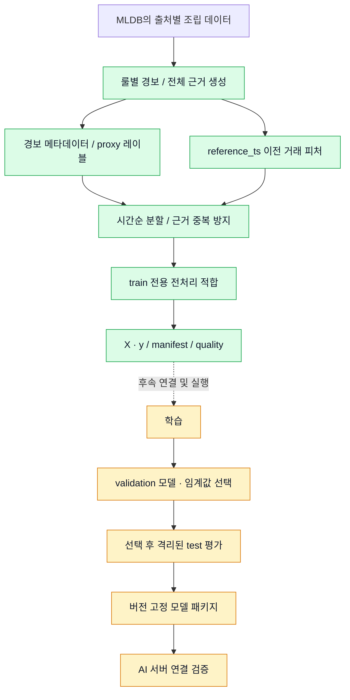
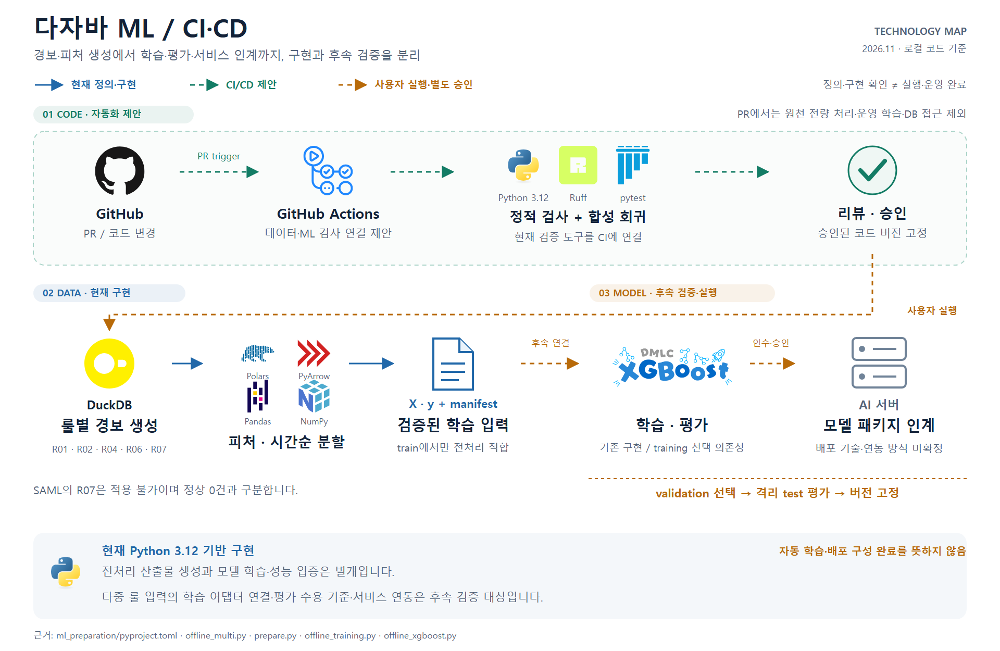
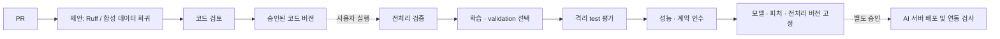

# dajaba-ml

**경보의 과거 거래를 피처로 만들고, 조사 우선순위 모델을 학습·평가하는 프로젝트입니다.**

> 2026-11-09 KST 갱신. 실제 ml_preparation 폴더의 구현을 설명합니다. 코드 존재, 전처리 실행, 학습 완료, 서비스 연동 완료를 구분합니다. GitHub 업로드 원본은 이 폴더이며 준비본을 사용하지 않습니다.

## 범위와 현재 상태

ml_preparation 패키지를 한 단위로 관리합니다. 같은 패키지 안에서 전처리와 학습이 공유하는 기능을 폴더 이름만으로 나누지 않습니다.

- 현재 오프라인 전처리 범위: R01·R02·R04·R06·R07.
- HI·LI: 다섯 룰. SAML: R01·R02·R04·R06, R07은 적용 불가로 구분.
- 2026-11-08 실행의 산출물 생성과 포맷 검증은 완료 보고됨. 모델 학습·성능 평가·서비스 ID 교차검증 완료를 뜻하지 않습니다.
- 기존 학습 코드를 다중 룰 산출물에 연결하는 어댑터와 평가 수용 기준은 별도 검증 대상입니다.
- 최신 리팩터링은 정적 검토와 사용자 실행 회귀 검증을 구분해서 인수합니다.

## 파이프라인



녹색은 현재 전처리 경로, 노란색은 이번 다중 룰 데이터 기준 후속 검증·실행 단계입니다. 데이터 생성 완료와 모델 성능 입증은 다릅니다.

## 적용 룰

| 룰 | 초기 적용 조건 |
| --- | --- |
| R01 | 24h 서로 다른 수신 계좌 5 이상 |
| R02 | 24h 서로 다른 송신 계좌 5 이상 |
| R04 | 72h, 최대 3홉 순환, 금액 조건 없음 |
| R06 | GATHER_SCATTER: 24h 입금 상대 3 이상 AND 출금 상대 3 이상, 선후 무관 |
| R07 | US Dollar 입금 [8,000, 10,000), 3건 이상, Cash 한정 없음 |

R01·R02·R07은 B7 분 단위 24h 창과 거짓→참 경보 생성 기준을 따릅니다. R06의 기존 BIPARTITE 의미를 재사용하지 않습니다. R03·R05·R08은 이번 실행 범위 밖입니다.

실제 조건값은 configs/offline_rules_v1_20261108.json의 params 의미와 키를 따릅니다. 오프라인 rule_versions는 백엔드 배포 버전과 별도 네임스페이스입니다. 백엔드 v1과 문자열이 같다고 가정하지 않고, 조건·창·근거를 대조합니다.

## SAML의 한계

SAML의 단일 Amount를 지급액과 수취액 양쪽으로 복제하지 않습니다. 방향별 원통화 금액은 확인되지 않은 값을 null로 유지합니다. US Dollar 수취액을 요구하는 R07은 적용 불가이며 정상 0건으로 표시하지 않습니다. 금액 분포가 비슷하다는 이유만으로 HI·LI와 의미가 같다고 추정하지 않습니다.

## 코드 안내

| 위치 | 역할 |
| --- | --- |
| ml_preparation/src/aml_ml/offline_multi.py | 전체 실행 순서 |
| offline_rule_sql.py | 룰별 후보 탐지 SQL |
| offline_multi_io.py | 입력 읽기와 출력 I/O |
| offline_multi_metadata.py | 경보·레이블·분할 메타데이터 |
| offline_multi_dataset.py | 피처와 X·y 출력 |
| offline_multi_recovery.py | 중단·재개 전 확인 |
| offline_multi_progress.py / offline_multi_diagnostics.py | 진행 기록과 진단 |
| preprocessing.py / offline_training.py / offline_xgboost.py | 전처리와 기존 학습 구현 |
| ml_preparation/tests | 합성 데이터와 회귀 검사 |
| ml_preparation/configs | 룰·입력·실행 설정 |

위 축약 파일명은 모두 ml_preparation/src/aml_ml 아래입니다. 진단 모듈의 실제 파일명은 offline_multi_diagnostics.py입니다.

## 데이터 계약

- 피처는 reference_ts보다 엄격히 이전의 관측만 사용합니다.
- 전체 경보 근거와 대상 계좌의 직접 입출금 집계는 구분합니다.
- 경로 중간 거래는 전체 근거로 보존하되 대상 계좌의 직접 금액에 더하지 않습니다.
- 원본 정답·pattern·ID는 모델 입력 피처가 아닙니다. proxy 레이블은 조사 확정 결과가 아닙니다.
- train에서만 전처리를 적합하고 validation으로 선택합니다. test는 선택 후 평가합니다.
- 분할 간 근거 중복 방지는 계좌·그래프 전체 독립성 보장이 아닙니다.
- 학습 UID를 실제 서비스 transaction_id로 추정하지 않습니다. 서비스 매핑은 원본 SHA-256과 행 번호를 기준으로 검증합니다.

## 환경과 사용

Python 3.12, DuckDB·PyArrow·Polars·Pandas·NumPy를 사용합니다. XGBoost는 training 선택 의존성입니다. 설치 기준은 ml_preparation/pyproject.toml입니다.

현재 입력 인덱스와 일부 테스트는 기존 MLDB 작업 공간에 의존합니다. 저장소 분리 후 독립 설치·작은 회귀 검증을 통과하기 전에는 clone 직후 실행 가능하다고 보지 않습니다. 전체 전처리 런처는 검사가 끝나면 데이터 생성까지 진행하므로 테스트만 할 때 사용하지 않습니다.

## CI/CD 구조

<!-- cicd-pipeline-image: ml-cicd-pipeline -->


[확대 가능한 SVG 원본](docs/images/ml-cicd-pipeline.svg)

실제 기술·라이브러리 로고로 구성한 그림입니다. 파란 실선은 현재 로컬에서 확인한 정의·구현, 초록 점선은 CI/CD 제안, 주황 점선은 사용자 실행·별도 승인 또는 후속 검증 단계입니다. 워크플로 정의와 실제 실행 성공은 구분하며, 미확정 배포 기술은 로고로 단정하지 않습니다. 아래 Mermaid와 기존 설명은 편집 가능한 요약으로 보존합니다.
<!-- /cicd-pipeline-image -->



이 CI/CD는 목표 구조입니다. 원격 ML 저장소에 자동 학습·배포가 구성되었다는 의미가 아닙니다. PR에서 원천 전체 처리나 모델 학습, 운영 DB 접근을 자동 실행하지 않습니다.

## 함께 보기

[다자바 MLDB](https://github.com/dajaba-team/dajaba-mldb)는 원천 검사와 기초 데이터 조립을 맡습니다. 공개 저장소에는 코드·안전한 설정 예시·합성 테스트·설명 문서만 올립니다.

## 현재 검증 진입점

상위 프로젝트 루트의 tools/Test-Release.ps1은 기존 .venv와 실제 DBcheck·AssembleDB·ml_preparation/src를 명시적으로 사용합니다. 사용자 실행용이며 이번 문서 갱신에서 검사를 실행하지 않았습니다. 운영 설정·완료된 run의 provenance는 수정하지 않았습니다.

현재 src/aml_ml은 MLDB 패키지를 import하지 않지만 tests/test_prepare.py는 DBcheck·AssembleDB로 합성 통합 입력을 생성합니다. 실제 폴더의 전체 회귀는 세 패키지를 함께 연결해 검사합니다. 별도 ML 저장소에서는 자체 검사와 이 통합 검사를 구별하고, MLDB 버전을 명시해야 합니다.

## 별도 ML 저장소에서의 설치와 검사

이 폴더 자체가 ML 저장소 루트가 됩니다. 아래 명령은 사용자 실행용이며 이번 변경에서는 실행하지 않았습니다.

```powershell
python -m pip install -e '.[training]' 'pytest>=8,<10' 'ruff>=0.9,<1'
python -m pytest tests --ignore=tests/test_prepare.py -q -p no:cacheprovider
```

test_prepare.py는 MLDB의 DBcheck와 AssembleDB를 사용하는 합성 통합 검사입니다. 삭제하거나 전체 통과에서 누락시키지 않고 별도로 두 패키지를 검토한 로컬 경로에서 설치한 후 실행합니다. ML 런타임 자체는 이 두 패키지를 import하지 않습니다.

```powershell
# 검토된 MLDB checkout 경로를 입력합니다. 동명 PyPI 패키지를 임의 설치하지 않습니다.
$mldb = Read-Host '검토된 MLDB 저장소 절대 경로'
python -m pip install -e (Join-Path $mldb 'DBcheck') -e (Join-Path $mldb 'AssembleDB')
python -m pytest tests/test_prepare.py -q -p no:cacheprovider
```

configs에는 공개 예제만 게시합니다. 기존 운영 설정은 로컬에 유지하며 tests/fixtures/legacy는 과거 N=10 및 미확정 정책의 회귀 검사 전용입니다. scripts/run_offline_rules_v1.py는 기존 고정 실행의 회귀 대상이며, 새 checkout의 범용 실행 명령으로 사용하지 않습니다.